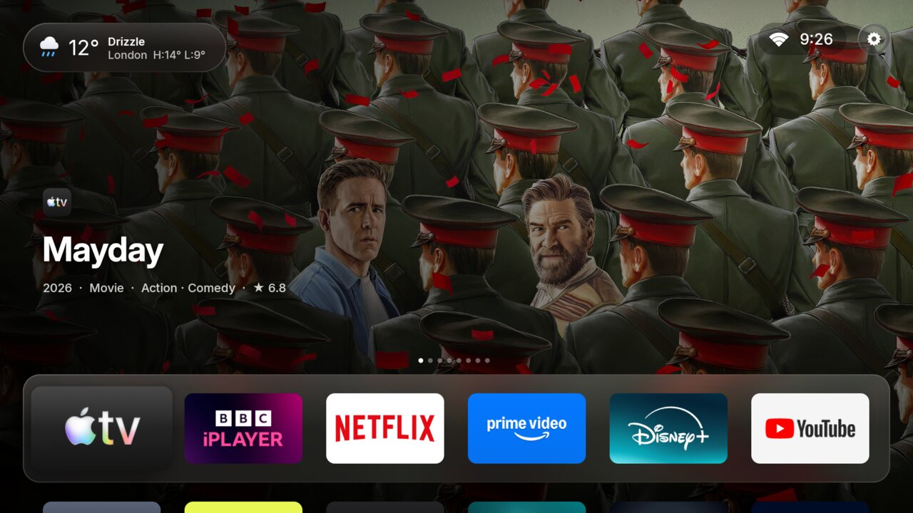
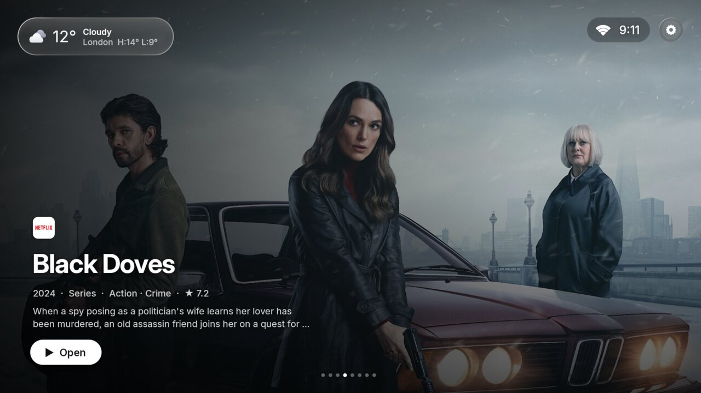
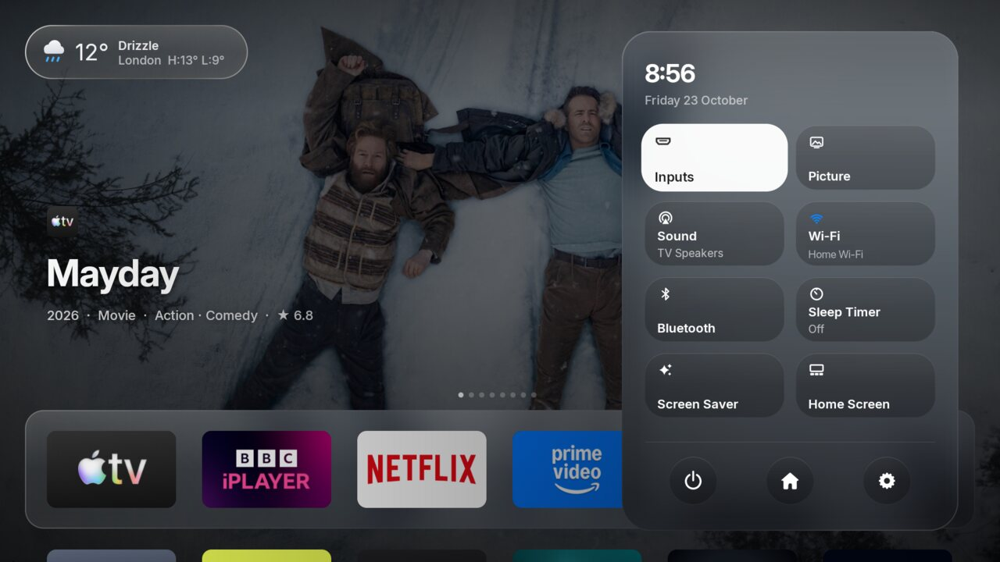
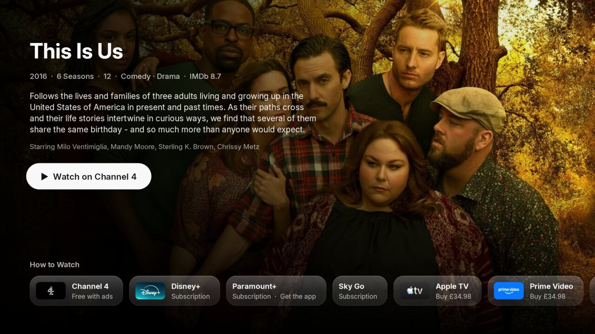
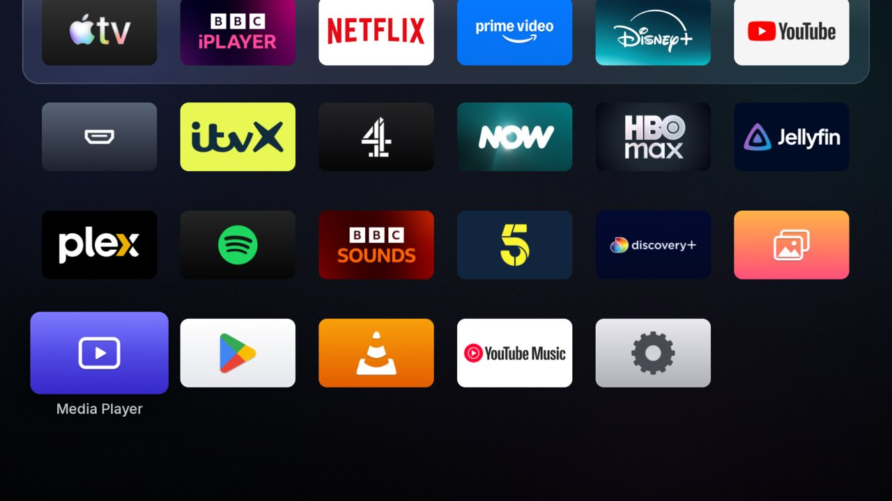
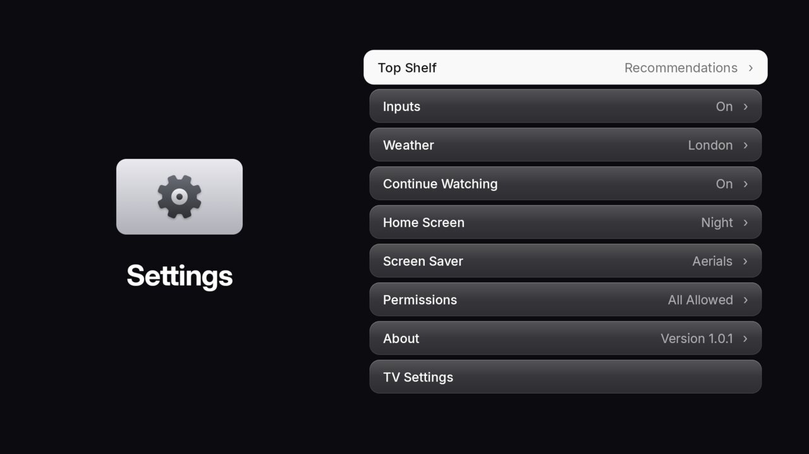

# Glass Home

**A clean, fast, Apple TV–style home screen for Android TV and Google TV**, with Liquid Glass
materials, a recommendations carousel, voice search, a Control Centre, and Apple's aerial screen
saver. Plus the scripts to strip the ads and tracking out of your TV, the way it's set up here.



| | |
|---|---|
|  |  |
|  |  |
|  |  |

Built for a TCL C6K Google TV in the UK, and it works on any Android TV or Google TV running
Android 7 or newer.

## What you get

- **A dock and a carousel.** Your six favourite apps sit in a glass dock over a full-screen
  carousel of what's trending on *your* services right now: recent, well rated (6.8+ on IMDb by
  enough people), nothing made for children. Settle on an app in the dock and the carousel switches
  to that app's own titles. Leave it alone and it goes full screen, then the screen saver takes over.
- **Liquid Glass everywhere.** The dock, Control Centre, the weather and clock are glass that takes
  its colour from the picture behind it, with spring motion on every focus change.
- **Apps open out of their tile**, the way they do on Apple TV, and Home brings you back to the
  app you left. Press Home twice for the **App Switcher**: your recent apps as big cards.
- **Control Centre** (the gear, or your remote's Quick Settings button, from any app): what's
  playing, with play and pause, then inputs, picture, sound, Wi-Fi, Bluetooth, sleep timer, screen
  saver and Glass Home's settings, as a glass panel over whatever you're watching.
- **Search that understands you.** Type, or hold the mic button and ask the way you'd ask a
  person: *slow horses*, *films like Inception*, *comedies with Will Ferrell*, *films directed by
  Greta Gerwig*, *documentaries about space*, *80s films*, *kids films*, *what's new on Netflix*,
  *Christmas films*. Answers come as tvOS shelves (Top Results with related titles, an actor's or
  director's work, what's trending in a genre), kept to what UK viewers watch and can watch, with
  IMDb and Rotten Tomatoes scores. The keyboard sits on the left as on tvOS, and the titles you
  open are kept under Recently Searched. Voice uses Google's speech service, not Gemini, and a glow
  runs round the search field while it listens. Every result opens a title page with the
  synopsis, cast, ratings, a Watch button and *How to Watch*: every UK service that streams, rents
  or sells it, labelled the way Apple labels them (*Stream* for a subscription you may or may not
  have, *Free with ads*, add-on channels as add-ons, rental and purchase prices). (Actors,
  directors and subjects need the free TMDB key below.)
- **A TV guide, like Freely's.** The Guide app (a card on Home) lists what's on across the BBC,
  ITV, Channel 4 and Channel 5 channels, a week back and a week ahead, from Freely's London guide.
  OK on something on now opens the channel live in its app; on something earlier, its catch-up.
- **Remote buttons that work.** Netflix, Prime Video, YouTube and Quick Settings, from any screen.
- **Apple's aerials as the screen saver.** 92 of Apple TV's aerial films in 4K, shuffled with no
  repeats, dissolving from one to the next. Press Up to see where you are, Right for the next one.
- **Weather** from the Met Office (or Open-Meteo, MET Norway, wttr.in) in the corner, with
  Apple's multicolour icons that follow day and night, and the next hours and 5 days a click away.
- **Settings that look the part**: everything from the dock order to the screen saver's timing, in
  tvOS-style pages.
- **Light and fast.** About 2 MB, plain Java with no libraries, tuned frame by frame on a
  mid-range TV.
- **No accounts, no tracking.** The only network calls are JustWatch (recommendations), TMDB
  (artwork, optional), your weather source, Freely (the Guide's listings) and Apple's video server
  (the screen saver).

Recommendations and *How to Watch* are for the UK (BBC iPlayer, ITVX, Channel 4, Netflix, Prime
Video, Disney+, Apple TV, NOW, HBO Max, Paramount+). Everything else works anywhere.

## Install

You need a computer with **adb** (Android's platform-tools) on the same network as the TV.

1. **Install adb.** Mac: `brew install android-platform-tools`. Windows: `winget install
   Google.PlatformTools`. Linux: `sudo apt install adb`.
2. **Switch on debugging on the TV.** Settings › System › About › press OK on **Android TV OS
   build** seven times. Then Settings › System › Developer options › **USB debugging** on (or
   **Wireless debugging** on newer TVs). Find the TV's IP address under Settings › Network.
3. **Get Glass Home** and run the installer:

```bash
git clone https://github.com/fraserstone97/glass-home.git
```

```bash
cd glass-home
```

```bash
TV_HOST=192.168.1.50 ./setup/install.sh
```

Use your TV's address instead of `192.168.1.50`. The first time, the TV asks to allow your
computer: tick *Always allow* and press **Allow**, then run the command again.

The installer downloads the latest release, installs Glass Home and Glass Aerials, makes Glass Home
your Home screen, and switches on voice search, the remote buttons and the screen saver. Follow the
short setup on the TV and you're done.

Rather do it by hand? Download `glass-home.apk` and `glass-aerials.apk` from
[Releases](https://github.com/fraserstone97/glass-home/releases/latest), then
`adb install glass-home.apk` and `adb install glass-aerials.apk`, and press Home on the remote.
The installer's extra steps (remote buttons, screen saver, voice) are in [`setup/install.sh`](setup/install.sh).

### Sharper artwork (optional, free)

The carousel uses JustWatch's pictures out of the box. With a free
[TMDB](https://www.themoviedb.org/settings/api) API key it uses each title's full-size key art
instead, which is noticeably sharper on a big TV. Sign up, request a key (Personal use), then:

```bash
TV_HOST=192.168.1.50 TMDB_KEY=your-api-key ./setup/install.sh
```

### Ad blocking (optional)

`AD_BLOCK_DNS=1` sets the TV's Private DNS to AdGuard, which blocks most in-app ads and trackers
(not YouTube's). Undo it any time with `restore.sh` or in Settings › Network.

## Set your TV up exactly like this one

Glass Home on its own is just a home screen. The full setup also switches off the bloat that ships
on most TVs: ad and tracking services, retail demos, preinstalled apps, the stock home's
recommendations. It's done safely: apps are **disabled, never uninstalled**, the TV's package lists
are backed up first, and one command puts everything back.

1. Install Glass Home (above) and check Home works.
2. Pick the list for your TV from [`setup/lists`](setup/lists), or one from
   [cleanyourtv's examples](https://github.com/Gathin23/cleanyourtv/tree/main/examples). Open it
   and comment out (`#`) anything your household uses.
3. See what it would do, then do it:

```bash
TV_HOST=192.168.1.50 DRY_RUN=1 ./setup/debloat.sh setup/lists/tcl-c6k-google-tv.txt
```

```bash
TV_HOST=192.168.1.50 ./setup/debloat.sh setup/lists/tcl-c6k-google-tv.txt
```

4. Restart the TV and check everything you use still works.
5. **Switch debugging off again** (see [Closing up](#closing-up)).

Prefer to let an AI agent (Claude Code, Codex, Gemini CLI…) do it, asking you before anything
your household uses? Point it at [`PROMPT.md`](PROMPT.md).

## Using it

- **Move an app:** hold OK on it, choose **Move**, use the arrows, press OK. The first row is the
  dock.
- **Hide an app:** hold OK, choose **Hide**. Hidden apps live in the *More Apps* folder.
- **Control Centre:** the gear at the top right, or your remote's Quick Settings button.
- **App Switcher:** press Home twice quickly. Left and right, OK to go back into an app.
- **Screen saver now:** on the first app in the dock, press Back.
- **Guide:** arrows move through channels and programmes; Up from the first channel picks the day;
  Back returns to now, then to Home. My5 can't be opened on a channel or a programme, so for
  Channel 5 the Guide opens My5 (live) or searches it (catch-up).
- **Glass Home's settings:** Control Centre › Home Screen. Top Shelf (which services, films or
  series), Weather, Home Screen (wallpaper, sounds, full screen when idle), Screen Saver (which one,
  when it starts, when the TV turns off), and more.
- **Holding volume:** on some TVs (TCL included) the firmware stops repeating a held button while
  any accessibility helper is listening, so holding volume moves one step at a time. That's the
  trade for the Netflix, Prime Video, YouTube and Quick Settings buttons working everywhere.

## Undo everything

```bash
TV_HOST=192.168.1.50 ./setup/restore.sh setup/lists/tcl-c6k-google-tv.txt
```

It switches every app in the list back on, makes the TV's own home your Home again, restores
Google's assistant and screen saver, switches Glass Home's helper off and puts DNS back to normal.
Add `UNINSTALL=1` to remove Glass Home and Glass Aerials too.

## Closing up

Debugging lets anything on your network control the TV, so switch it off when you're done:
Settings › System › Developer options › **Revoke USB debugging authorisations**, then switch
**USB debugging** and **Wireless debugging** off, and restart the TV. Glass Home keeps working; you
only need debugging again to update it or change the debloat.

## Troubleshooting

- **Home opens a setup screen instead of Glass Home.** On Google TV the setup wizard can grab the
  Home button. Run `install.sh` again; if Home still isn't Glass Home, disable the wizard: `adb shell
  pm disable-user --user 0 com.google.android.tungsten.setupwraith`. **Check first**:
  `adb shell dumpsys wifi | grep -o 'cname=[^ ]*'`. If it names `setupwraith`, the wizard owns your
  saved Wi-Fi network and disabling it drops the TV off Wi-Fi: reconnect to Wi-Fi in Settings first.
- **The remote's Netflix / Prime / YouTube / Quick Settings buttons stopped working.** Something
  switched the helper off (a force-stop does). Open Glass Home once and it switches itself back on;
  or run `install.sh` again.
- **The carousel is empty.** It needs the internet and a minute after the first start. Check
  Control Centre › Home Screen › Top Shelf.
- **A firmware update brought apps back.** Run `debloat.sh` with your list again.

## Build from source

Needs JDK 17 and the Android SDK (build-tools 34.0.0, platform android-34). No Gradle.

```bash
TV_HOST=192.168.1.50 BUILD=1 ./setup/install.sh
```

Or build each app: `cd launcher && ./build.sh` (and `cd aerials && ./build.sh`). `APP_NAME="My
Home" ./build.sh` changes the name the TV shows. Code is plain Java with no dependencies:
`launcher/src/app/glasshome/launcher` and `aerials/src/app/glasshome/aerials`.

## Credits

- [cleanyourtv](https://github.com/Gathin23/cleanyourtv) (MIT), whose method and safety rules the
  setup scripts follow.
- Recommendations from [JustWatch](https://www.justwatch.com); artwork from
  [TMDB](https://www.themoviedb.org). This product uses the TMDB API but is not endorsed or
  certified by TMDB.
- Aerial films stream from Apple and aren't included here.

Glass Home isn't affiliated with Apple, Google, TCL or any streaming service. Apple TV and tvOS are
Apple's trademarks; app logos belong to their owners and are drawn from each app installed on your
TV.

## Licence

Apache License 2.0. See [LICENSE](LICENSE) and [NOTICE](NOTICE).
